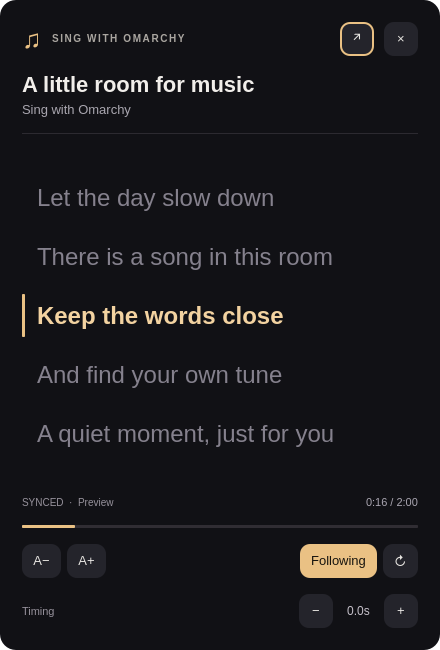

# Sing with Omarchy

Keep the words close. A lyrics reader for Omarchy, by Akash A.



*Preview uses original sample text, not lyrics from a recording.*

Play a song, open the music-note button in your bar, and follow along. Timed
lyrics highlight the current line. You can open a separate window, change the
text size, or scroll back without losing your place in the song.

## Features

- Automatic track detection through MPRIS, with a player picker when needed.
- Synchronized lyrics from LRCLIB and plain-text fallback from Lyrics.ovh.
- A compact bar popup and a separate, resizable lyrics window.
- Click a timed line to seek when your player supports seeking.
- Manual scrolling pauses following; **Follow** brings you back.
- Text sizes from 16–40 px and a per-song timing adjustment of ±10 seconds.
- Clear loading, instrumental, unavailable, and connection-error states.
- A bounded in-memory cache, stale-response protection, and provider cooldowns.

Plain lyrics are shown without pretending they have timestamps. The window
manager decides whether the separate window floats or tiles; use your normal
Omarchy window controls to move or float it.

## Requirements

Omarchy with its Quickshell plugin host, Qt Quick Controls, Python 3, an
MPRIS-compatible music player, and internet access for lyrics lookup. The
Python helper uses only the standard library. No API keys or account login
are needed.

Development checks use Omarchy 4.0.6, Qt 6.12, and the installed Quickshell.
See [validation notes](docs/validation.md) for the exact tested scope.

## Install

```bash
omarchy plugin add https://github.com/akashanil-dev/sing-with-omarchy.git --enable
```

The plugin ID is `akash.sing-with-omarchy`. It installs alongside other lyrics
plugins; it does not replace or remove them.

To move its bar button:

```bash
omarchy bar move akash.sing-with-omarchy --section right
```

Open or close the popup from a shortcut using:

```bash
omarchy-shell akash.sing-with-omarchy toggle
```

`show`, `hide`, `refresh`, and `status` are also available. Commands open the
reader on the focused monitor, falling back to an available widget. `hide`
closes popups and detached windows on every monitor. `status` reports whether
any reader is open without including the song metadata.

## Try the interface without installing

From this checkout, run:

```bash
quickshell -p preview.qml
```

The preview has fixed sample text and does not query lyrics providers. It does
not change your bar or plugin configuration.

## Controls

| Control | Action |
| --- | --- |
| Music-note bar button | Open or close the reader |
| ↗ | Open lyrics in a separate window |
| A− / A+ | Change lyric text size |
| Scroll | Read manually and pause following |
| Follow | Return to the current line |
| Click a timed line | Seek to that part of the song |
| Timing − / + | Show lyrics later / sooner, in half-second steps |
| ↻ | Retry the lyrics lookup |
| × | Close that reader |
| Escape in the separate window | Close the window |

Text size lasts for the current session. Timing resets for each recording.
When several players are available, selecting one keeps it selected until it
disappears; otherwise the plugin prefers a playing source.

## Matching and privacy

LRCLIB receives the track title, artist, album, and duration. The fallback
provider receives the artist and title. Search results are checked against the
recording metadata; live, remix, and other version markers are not silently
discarded. Incorrect player metadata can prevent a match.

Lyrics stay in memory, with up to 20 successful lookups retained during the
session. No listening history or lyric files are written to disk. Requests
use HTTPS, reject redirects, cap response sizes, and wait after rate limits.
Track metadata travels to the helper over a private stdin pipe; it is never
placed in process arguments or environment variables. Other processes running
as your own user or as root are outside that privacy boundary.

Network responses are limited to 1 MiB before decompression and 2 MiB after
gzip decompression. Lyric fields, line counts, matching inputs, and helper
output have separate limits. An independent supervisor caps output at 512 KiB
before QML collects it and kills a lookup that exceeds 22 seconds. The helper
also has its own 20-second deadline. There is no analytics or telemetry.

Lyrics belong to their respective rights holders. Provider availability,
coverage, and timing accuracy vary.

## Development

```bash
bash scripts/check.sh
```

The checks include Python tests, QML interaction/render tests, a Quickshell
session test, a subprocess race test, and manifest validation when Omarchy is
available. Tests use synthetic text and mocked provider responses.

The implementation is split into `Session.qml` (playback, reader coordination,
and request state),
`Reader.qml` (shared reader), `Widget.qml` (Omarchy host integration),
`ServiceLink.qml` (late service discovery), `Timeline.js` (cue lookup),
`Protocol.js` (message validation), `backend/lyrics.py` (provider client), and
`backend/worker.py` (private pipes, output limits, and process deadlines).

## Remove

```bash
omarchy plugin remove akash.sing-with-omarchy
```

## License and dependencies

Code: [MIT](LICENSE), copyright Akash A.

Runs on [Omarchy](https://omarchy.org/), [Quickshell](https://quickshell.org/),
Qt, and Python. Those projects retain their own licenses. Lyrics are supplied
by [LRCLIB](https://lrclib.net/) and [Lyrics.ovh](https://lyrics.ovh/); they are
not covered by this repository's code license.
